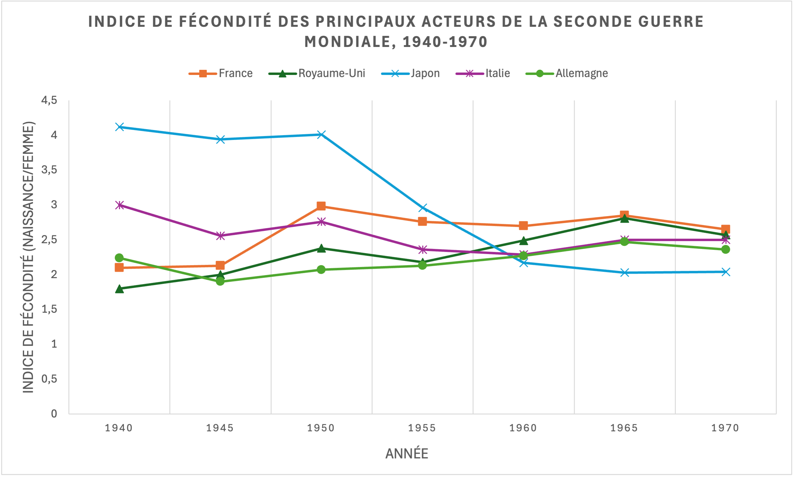

# La tendance du baby boom

Ana Savard  
Université Laval  
2026-12-11

## 1. Question de recherche et hypothèse
Le baby-boom est un événement qui a été très marquant pour l'histoire du Canada. Les enseignants au secondaire nous parlaient de comment la fin de la Seconde Guerre mondiale, l'amélioration des conditions de vie et l'euphorie générale de la population a favorisé une augmentation des taux de naissance, créant ainsi une nouvelle génération des «Baby boomers ». Selon Statistiques Québec, cette génération se situe en 1946 et 1965, en pleine période de prospérité (Statistiques Québec, 2026). Pour l'histoire canadienne et québécoise, cela a été un immense événement, mais est-ce que le baby-boom a eu lieu dans les autres pays impactés par la guerre? Dans ce travail, on tentera de répondre à la question suivante: Est-ce que l'intensité de la Seconde Guerre mondiale a eu des effets sur le baby-boom pour les principaux acteurs du conflit? En se basant sur les différentes sources, on peut s'imaginer que bien que la France, le Royaume-Uni, le Japon, l'Italie et l'Allemangne ont vécu la guerre plus directement qu'au Canada, cela n'empêche pas qu'ils ont vécu, è leur rythme, une forme de baby-boom. Il est important de mentionner ici que l'URSS ne sera pas présente puisqu'il a été très difficile de trouver des données fiables.

Durant cette étape, plusieurs outils ont été utilisé pour faire la synthèse des références. Afin d'avoir un certain aperçu des sources disponibles, Concensus a été utilisé en premier. Cela a permis de brosser un portrait assez large de la recherche sur le baby-boom. Lorsqu'une source était considérée comme intéressante mais non-accessible via le site de Concensus, j'ai utilisé Sofia, le site de la bibliothèque de l'Université Laval. En mettant les références dans son système, je pouvais donc avoir accès à la source proposée par Concensus. J'ai aussi utilisé Google Scholar avec Sofia, puisque ce ne sont pas toutes les références dans Google Scholar qui sont accessibles gratuitement. Je ne regardais pas nécessairemtn le nombre de citations de la source, mais puisque Google Scholar présente toute les références qui pourraient porter sur le baby-boom, cela m'a permis d'aller en profondeur dans ma recherche. J'ai également utilisé Word pour pouvoir prendre des notes des informations. Pour finir, j'ai aussi utilisé Zotero comme outil de gestion de références pour m'aider dans la bibliographie se trouvant à la fin du texte.

## 2. Collecte de données

## 3. Analyse et visualisation des données

## 6. Discussion
[Direct answer to the research objective.]

## Bibliographie
1. https://statistique.quebec.ca/vitrine/vieillissement/themes/population/pyramide-ages-animee